# POS

## Platforma za prodaju i upravljanje zalihama maloprodajnih firmi sa više prodavnica i skladišta

**Product pitch i dokument početne faze projekta (RUP, faza Inception)**

| | |
|---|---|
| **Organizacija** | vendora-org |
| **Projekat** | POS |
| **Predmet** | Metodologije razvoja softvera |
| **Verzija dokumenta** | 1.0 |
| **Datum** | 14.10.2026. |
| **Status** | Za prezentaciju na prvom kolokvijumu |

**Projektni tim**

| Student | Broj indeksa |
|---|---|
| Mladen Stanimirović | 2024270810 |
| Jovan Vidović | 2024270139 |
| Vladimir Mileticki | 2024271334 |
| Lazar Vučković | 2024270016 |

**Istorija izmena**

| Verzija | Datum | Opis |
|---|---|---|
| 1.0 | 14.10.2026. | Prva verzija dokumenta početne faze |

---

## Sadržaj

1. Sažetak
2. Opis problema
3. Predlog rešenja i vizija proizvoda
4. Ciljna grupa i korisničke uloge
5. Tržište i konkurencija
6. Obim projekta
7. Kandidatska lista zahteva
8. Preliminarni model sistema
9. Preliminarna arhitektura i tehnološki stek
10. Metodologija razvoja i plan projekta
11. Tim, alati i organizacija rada
12. Upravljanje rizicima
13. Okvirna procena troškova i opravdanosti
14. Validacija ideje i kriterijumi uspeha
15. Kriterijumi za završetak početne faze i naredni koraci
16. Prilog A: Pojmovnik
17. Prilog B: Pravni okvir i fiskalizacija

---

## 1. Sažetak

Mali i srednji trgovci koji posluju na više lokacija najčešće vode zalihe u tabelama, u lokalnim programima po prodavnici ili u kombinaciji oba. Podaci o stanju robe se zato usklađuju ručno, sa zakašnjenjem i uz greške. Posledice su poznate: roba nestaje sa polica u jednoj prodavnici dok istovremeno leži neprodata u drugoj, nabavka se radi na osnovu pretpostavki, a vlasnik pravu sliku poslovanja dobija tek nakon zatvaranja meseca.

POS je veb aplikacija koja sve prodavnice i skladišta jedne firme povezuje u jedan sistem. Obuhvata:

- evidenciju prodaje na kasi,
- stanje zaliha po lokaciji u realnom vremenu,
- prenos robe između lokacija sa potvrdom otpreme i prijema,
- nabavku od dobavljača i prijem robe,
- uloge korisnika (prodavac, magacioner, menadžer, vlasnik) sa ograničenim pravima,
- izveštaje o prodaji, zalihama i prometu.

Proizvod je namenjen firmama sa 3 do 20 lokacija koje su preraste tabelarnu evidenciju, a za koje su opšti ERP sistemi preskupi i prekomplikovani za uvođenje. Poslovni model je mesečna pretplata (SaaS). Razvoj se planira u trajanju od 24 nedelje, po metodologiji RUP, sa Scrum sprintovima od dve nedelje unutar iteracija. Okvirna procena ukupnog rada je 1.920 sati, a prag isplativosti operativnih troškova dostiže se sa pet plaćenih klijenata.

Ovaj dokument predstavlja rezultat početne faze (Inception): obrazlaže problem i rešenje, definiše obim i kandidatsku listu zahteva, daje preliminarni model i arhitekturu, plan po RUP fazama, registar rizika i okvirnu procenu troškova.

---

## 2. Opis problema

### 2.1 Postojeće stanje

Tipična firma iz ciljne grupe ima nekoliko prodavnica i jedno do dva skladišta. Evidencija se vodi na jedan od sledećih načina:

- zasebne Excel tabele po lokaciji, koje se periodično šalju mejlom ili preko poruka,
- lokalni kasovni programi koji ne dele podatke između prodavnica,
- papirna dokumentacija (otpremnice, prijemnice) koja se naknadno prepisuje.

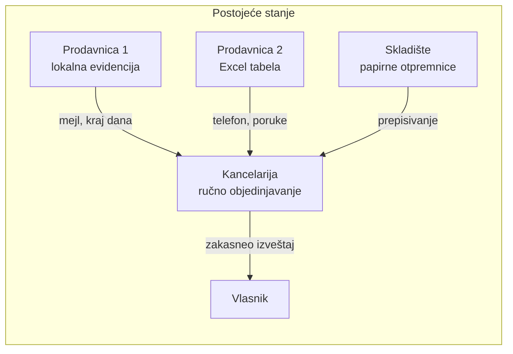

### 2.2 Posledice

| Posledica | Kako nastaje |
|---|---|
| Netačno stanje zaliha | Prodaja i prenosi se upisuju sa zakašnjenjem ili se ne upišu uopšte. Evidencija se razlikuje od stvarnog stanja. |
| Neravnomerna raspodela robe | Nema uvida u to koja prodavnica ima višak, a koja manjak istog artikla, pa se roba ne prenosi na vreme. |
| Izgubljena prodaja | Kupac traži artikal koji prodavac nema na stanju, iako ga firma ima u susednoj prodavnici ili u skladištu. |
| Višak zaliha i vezan novac | Nabavka se radi bez pouzdanih podataka o prometu i stanju na svim lokacijama. |
| Spor uvid u poslovanje | Vlasnik i menadžer podatke dobijaju tek posle ručnog objedinjavanja, često sa razlikom od nekoliko dana. |
| Nema odgovornosti | Ne zna se ko je i kada promenio stanje, pa se razlike (manjkovi, rastur) teško objašnjavaju. |

### 2.3 Zašto postojeća rešenja ne rešavaju problem

Univerzalni ERP sistemi pokrivaju problem, ali zahtevaju implementaciju, obuku i konfiguraciju koja za firmu sa nekoliko prodavnica košta više nego što se vraća. Jednostavniji kasovni programi nisu projektovani za više lokacija i prenos robe između njih. Tabele ostaju jer su besplatne i poznate, ali ne obezbeđuju kontrolu pristupa, istoriju promena ni rad više ljudi istovremeno.

---

## 3. Predlog rešenja i vizija proizvoda

### 3.1 Izjava o viziji

> Za **vlasnike i menadžere maloprodajnih firmi sa više prodavnica i skladišta** kojima je potreban pouzdan uvid u prodaju i zalihe na svim lokacijama,
> **POS** je **veb aplikacija za prodaju i upravljanje zalihama**
> koja **povezuje sve lokacije u jedan sistem i u realnom vremenu prati stanje robe, prenose i nabavku**.
> Za razliku od **tabela i nepovezanih lokalnih programa**, ali i od **složenih ERP sistema**,
> naš proizvod je **jednostavan za uvođenje, prilagođen malim i srednjim firmama i dostupan putem pretplate**.

### 3.2 Ciljevi proizvoda

1. Jedinstveno i tačno stanje zaliha za svaki artikal na svakoj lokaciji, ažurno u trenutku prodaje.
2. Kontrolisan prenos robe između lokacija sa jasnim stanjima (zahtev, odobrenje, otprema, prijem) i evidentiranjem razlika.
3. Evidencija nabavke i prijema robe po porudžbenici.
4. Jasna podela odgovornosti kroz uloge i evidenciju radnji.
5. Izveštaji koji omogućavaju brzo donošenje odluka bez ručnog objedinjavanja.

### 3.3 Prikaz vrednosti po ulogama

| Uloga | Problem danas | Šta pruža POS |
|---|---|---|
| Prodavac | Ne zna da li artikla ima u drugoj prodavnici, ručno beleži prodaju | Brz unos računa, uvid u stanje po lokacijama, automatsko smanjenje zaliha |
| Magacioner | Papirne otpremnice, ručno usklađivanje sa prodavnicama | Digitalni prenosi i prijemi, popis, korekcije sa evidencijom |
| Menadžer | Nedostaje pregled nad prodavnicama, nabavka po osećaju | Pregled zaliha i prometa, upozorenja o minimalnim količinama, porudžbenice |
| Vlasnik | Izveštaj stiže sa zakašnjenjem | Izveštaji i pregled poslovanja svih lokacija u svakom trenutku |

---

## 4. Ciljna grupa i korisničke uloge

### 4.1 Ciljni segment

Primarni segment su maloprodajne firme u Srbiji sa 3 do 20 lokacija (prodavnice i najmanje jedno skladište) iz delatnosti sa većim brojem artikala i čestim kretanjem robe između lokacija: građevinski i tehnički materijal, kozmetika i higijena, odeća i obuća, autodelovi, prehrambena roba sa dužim rokom trajanja, cvećare i hortikultura sa većim brojem prodajnih mesta.

Kupac proizvoda (onaj ko plaća pretplatu) je vlasnik ili direktor firme, a svakodnevni korisnici su zaposleni u prodavnicama i skladištima.

### 4.2 Korisničke uloge

| Uloga | Opis | Pristup |
|---|---|---|
| **Prodavac** | Radi u jednoj ili više prodavnica, izdaje račune | Prodaja, pregled stanja svoje lokacije, zatvaranje smene |
| **Magacioner** | Radi u skladištu ili prodavnici, zadužen za robu | Zalihe, korekcije, popis, otprema i prijem prenosa, prijem od dobavljača |
| **Menadžer** | Odgovoran za jednu ili više lokacija | Sve operativno za svoje lokacije, odobravanje prenosa, porudžbenice, izveštaji |
| **Vlasnik** | Vlasnik firme | Pregled svih lokacija i izveštaja, upravljanje korisnicima i lokacijama |

Pristup podacima je ograničen i ulogom i lokacijom. Prodavac jedne prodavnice ne vidi podatke druge, a menadžer vidi samo lokacije koje su mu dodeljene.

---

## 5. Tržište i konkurencija

Konkurenciju delimo u četiri kategorije. Procena je preliminarna, zasnovana na javno dostupnim opisima proizvoda, i biće dopunjena u fazi Elaboration.

| Kategorija | Primeri | Prednosti | Ograničenja u odnosu na ciljnu grupu |
|---|---|---|---|
| Tabele i ručna evidencija | Excel, Google Sheets | Besplatno, poznato | Nema kontrole pristupa, nema istorije, greške pri istovremenom radu, nema automatskog povezivanja prodaje i zaliha |
| Opšti ERP sistemi | Odoo, SAP Business One | Pokrivaju sve poslovne procese | Složeno uvođenje, obuka i konfiguracija, ukupan trošak preveliki za malu firmu |
| Specijalizovani maloprodajni sistemi (SaaS) | Lightspeed Retail, Zoho Inventory | Zrela funkcionalnost, višelokacijski rad | Cena u stranoj valuti, ograničena lokalizacija, nije prilagođeno srpskim propisima |
| Lokalna poslovna rešenja | Programi za knjigovodstvo i magacinsko poslovanje domaćih proizvođača | Prilagođeni propisima i računovodstvu | Najčešće desktop arhitektura i licenciranje po instalaciji, slabiji rad između lokacija u realnom vremenu |

### 5.1 Pozicioniranje

POS se pozicionira između tabela i ERP sistema: pokriva samo ono što višelokacijskoj maloprodaji treba (prodaja, zalihe, prenosi, nabavka, izveštaji), uvodi se bez implementacionog projekta i naplaćuje mesečno. Razlikovne vrednosti su:

1. fokus na kretanje robe između lokacija kao centralni proces, a ne kao dodatak,
2. jednostavno uvođenje (uvoz artikala, kreiranje lokacija i korisnika u nekoliko koraka),
3. kontrola pristupa po ulozi i lokaciji uz evidenciju svake promene stanja,
4. lokalizacija na srpski jezik, dinar i PDV stope.

---

## 6. Obim projekta

### 6.1 U obimu prve isporuke (MVP)

- Prijava i upravljanje korisnicima, ulogama i dodelom lokacija.
- Katalog artikala sa kategorijama, barkodovima, jedinicama mere, cenama i PDV stopama.
- Upravljanje lokacijama (prodavnice i skladišta).
- Stanje zaliha po lokaciji, minimalne količine, korekcije, otpis i popis.
- Izdavanje računa, načini plaćanja, storno i zatvaranje smene.
- Prenos robe između lokacija sa tokom odobravanja, otpreme i prijema.
- Dobavljači, porudžbenice i prijem robe (uključujući delimičan prijem).
- Izveštaji i pregled poslovanja, izvoz u CSV i PDF.
- Evidencija radnji (audit log).
- Čitač barkoda koji radi kao tastatura (bez posebnog drajvera).

### 6.2 Van obima prve isporuke

| Stavka | Razlog |
|---|---|
| Integracija sa sistemom fiskalizacije (ESIR, PFR, SUF) | Zahteva posebnu sertifikaciju kod Poreske uprave. Arhitektura ostavlja predviđeno mesto za integraciju (videti Prilog B i rizik R-01). |
| Rad bez internet veze (offline kasa) | Značajno povećava složenost sinhronizacije. Prva verzija zahteva stalnu vezu. |
| Elektronska trgovina (veb prodavnica) | Zaseban proizvod sa drugim korisnicima. |
| Integracija sa knjigovodstvenim softverom | Planira se kao naredna verzija, izvoz u CSV je privremeno rešenje. |
| Mobilna aplikacija | Veb aplikacija je prilagođena (responsive) za tablet i telefon. |
| Programi lojalnosti, popusti po kampanjama | Nije neophodno za osnovni proces. |
| Upravljanje rokom trajanja i serijama | Predmet je kasnije verzije. |

---

## 7. Kandidatska lista zahteva

Lista je sastavljena prema pristupu iz predavanja: uz svaki zahtev navode se status, prioritet, procenjeni trošak implementacije i nivo rizika. Svi zahtevi su u statusu **Predlog**, a u fazi Elaboration prelaze u **Prihvaćeno**, zatim **Uključeno** i **Provereno**.

Skala prioriteta: *Kritično*, *Važno*, *Preporučuje se*. Skala rizika: *Mali*, *Srednji*, *Značajan*, *Kritičan*. Procena je izražena u čovek-danima (č-d, jedan dan = 8 sati).

### 7.1 Funkcionalni zahtevi

| ID | Zahtev | Uloga | Prioritet | Rizik | Procena (č-d) | Status |
|---|---|---|---|---|---|---|
| F-01 | Prijava na sistem preko Keycloak-a (OIDC) | Sve | Kritično | Srednji | 6 | Predlog |
| F-02 | Upravljanje korisnicima, ulogama i dodelom lokacija | Vlasnik | Kritično | Srednji | 8 | Predlog |
| F-03 | Katalog artikala (šifra, barkod, naziv, jedinica mere, PDV, cena) | Menadžer | Kritično | Mali | 8 | Predlog |
| F-04 | Kategorije artikala i cenovnik | Menadžer | Važno | Mali | 5 | Predlog |
| F-05 | Upravljanje lokacijama (prodavnice i skladišta) | Vlasnik | Kritično | Mali | 4 | Predlog |
| F-06 | Pregled stanja zaliha po lokaciji i ukupno | Sve | Kritično | Značajan | 7 | Predlog |
| F-07 | Minimalne količine i upozorenja o niskoj zalihi | Menadžer | Važno | Mali | 4 | Predlog |
| F-08 | Korekcija zaliha i otpis (kalo, rastur, oštećenje) uz razlog | Magacioner | Važno | Srednji | 5 | Predlog |
| F-09 | Popis (inventura) i usklađivanje stanja | Magacioner | Važno | Srednji | 9 | Predlog |
| F-10 | Izdavanje računa (pretraga, barkod, više stavki, popust) | Prodavac | Kritično | Značajan | 14 | Predlog |
| F-11 | Evidencija načina plaćanja (gotovina, kartica) | Prodavac | Važno | Mali | 3 | Predlog |
| F-12 | Storno računa i povraćaj robe | Prodavac | Važno | Srednji | 6 | Predlog |
| F-13 | Zatvaranje smene i dnevni izveštaj kase | Prodavac | Preporučuje se | Mali | 6 | Predlog |
| F-14 | Zahtev za prenos robe između lokacija | Magacioner, menadžer | Kritično | Srednji | 5 | Predlog |
| F-15 | Odobravanje ili odbijanje prenosa | Menadžer | Važno | Mali | 3 | Predlog |
| F-16 | Otprema i prijem prenosa sa evidencijom razlika | Magacioner | Kritično | Značajan | 9 | Predlog |
| F-17 | Evidencija dobavljača | Menadžer | Važno | Mali | 3 | Predlog |
| F-18 | Kreiranje i slanje porudžbenice | Menadžer | Važno | Srednji | 7 | Predlog |
| F-19 | Prijem robe po porudžbenici (potpun i delimičan) | Magacioner | Važno | Srednji | 8 | Predlog |
| F-20 | Izveštaj o prodaji po periodu, lokaciji, artiklu i prodavcu | Menadžer, vlasnik | Kritično | Srednji | 7 | Predlog |
| F-21 | Kartica artikla i izveštaj o prometu zaliha | Menadžer | Važno | Mali | 5 | Predlog |
| F-22 | Predlog dopune zaliha (artikli ispod minimuma) | Menadžer | Preporučuje se | Srednji | 5 | Predlog |
| F-23 | Pregled poslovanja (dashboard) za vlasnika | Vlasnik | Preporučuje se | Srednji | 6 | Predlog |
| F-24 | Izvoz izveštaja u CSV i PDF | Menadžer, vlasnik | Preporučuje se | Mali | 4 | Predlog |
| F-25 | Evidencija radnji (ko, šta, kada) | Vlasnik | Važno | Mali | 4 | Predlog |

Ukupna procena funkcionalnih zahteva je **151 č-d**. Preostalih 89 č-d (od ukupnih 240) odnosi se na arhitekturu i infrastrukturu (20), testiranje (30), dokumentaciju i upravljanje projektom (25) i rezervu (14).

### 7.2 Nefunkcionalni zahtevi

| ID | Oblast | Zahtev i mera | Prioritet |
|---|---|---|---|
| N-01 | Konzistentnost podataka | Stanje zalihe nikada ne sme postati negativno. Svaka promena stanja je atomarna i prati se u istoj transakciji sa dokumentom koji je izaziva (račun, prenos, prijem, korekcija). | Kritično |
| N-02 | Bezbednost | Autentikacija preko OIDC (Keycloak), autorizacija po ulozi i lokaciji, sav saobraćaj preko HTTPS, lozinke ne čuvaju se u aplikaciji. | Kritično |
| N-03 | Performanse | 95% API zahteva se obradi za manje od 500 ms pri 100 istovremenih korisnika. Izdavanje računa sa 5 stavki traje manje od 60 s od strane prodavca. | Važno |
| N-04 | Skalabilnost | Sistem podržava najmanje 20 lokacija, 50.000 artikala i 500.000 računa godišnje bez degradacije. | Važno |
| N-05 | Dostupnost | 99,5% dostupnosti u radnom vremenu prodavnica (mereno mesečno). | Važno |
| N-06 | Oporavak podataka | Dnevna rezervna kopija baze, cilj tačke oporavka (RPO) 24 sata, cilj vremena oporavka (RTO) 4 sata. | Važno |
| N-07 | Sledljivost | Svaka promena stanja zaliha i prava pristupa beleži se sa korisnikom i vremenom i ne može se izmeniti iz aplikacije. | Važno |
| N-08 | Upotrebljivost | Interfejs na srpskom jeziku (latinica), prilagođen tabletu i telefonu, osnovne radnje dostižne u najviše tri klika. | Važno |
| N-09 | Prenosivost | Celo okruženje se pokreće jednom komandom (kontejneri), isti artefakti se koriste u razvoju, testu i produkciji. | Važno |
| N-10 | Održivost koda | Slojevita (clean) arhitektura, automatsko testiranje u CI pipeline-u, pokrivenost domenskog sloja testovima od najmanje 70%. | Važno |
| N-11 | Lokalizacija | Valuta dinar, PDV stope prema važećim propisima, format datuma i brojeva prema srpskim standardima. | Preporučuje se |

---

## 8. Preliminarni model sistema

Modeli u ovom poglavlju su početni i dopunjuju se u fazi Elaboration. Služe da pokažu da je obim razumljiv i da su ključni pojmovi domena identifikovani.

### 8.1 Kontekst sistema

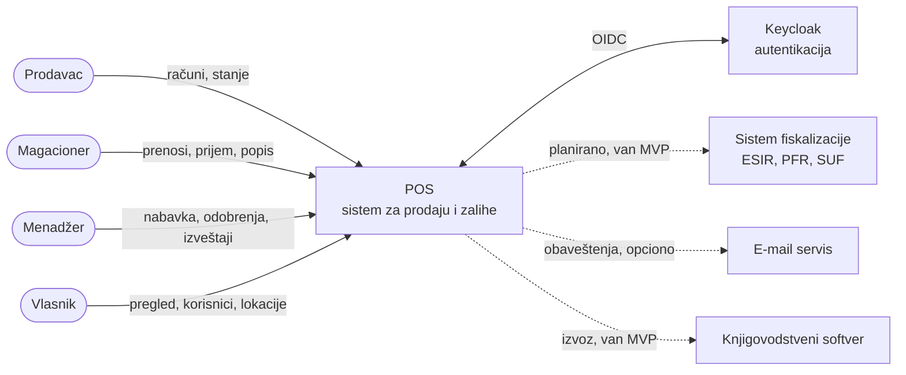

Punom linijom su prikazane veze obuhvaćene prvom isporukom, isprekidanom planirane ili opcione.

### 8.2 Pregled slučajeva korišćenja

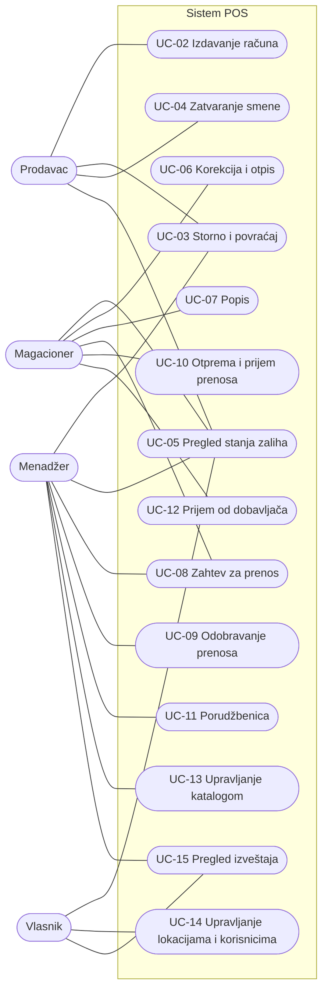

Slučaj korišćenja UC-01 (Prijava na sistem) koriste svi akteri i zbog preglednosti nije prikazan na dijagramu. Detaljni opisi svakog slučaja (preduslovi, glavni tok, alternativni tokovi, postuslovi) izrađuju se u fazi Elaboration.

### 8.3 Model domena

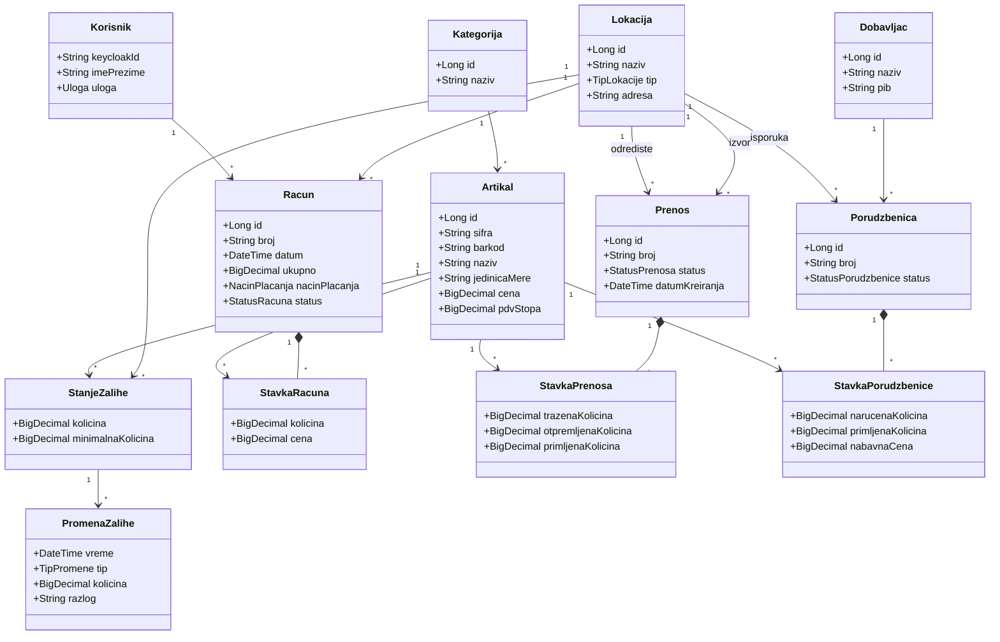

Klasa `PromenaZalihe` je dnevnik svake promene stanja i povezuje stanje sa dokumentom koji ga je izazvao (račun, prenos, prijem, korekcija). Na osnovu nje se računa kartica artikla i proverava tačnost stanja.

### 8.4 Ključni tok: izdavanje računa

Izdavanje računa je najosetljiviji tok jer istovremeno menja zalihu iz više prodavnica. Preliminarno rešenje je uslovno ažuriranje u okviru jedne transakcije, čime se sprečava negativno stanje i kada dva prodavca istovremeno prodaju poslednji komad.

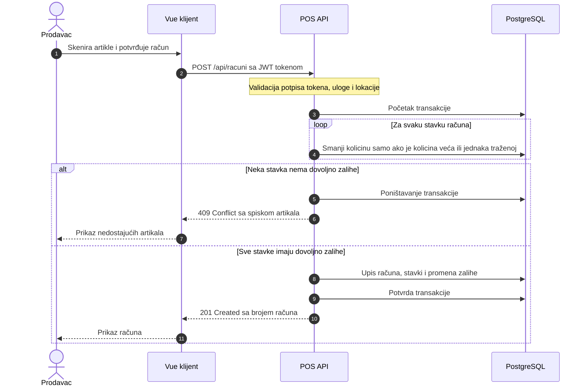

### 8.5 Ključni tok: prenos robe između lokacija

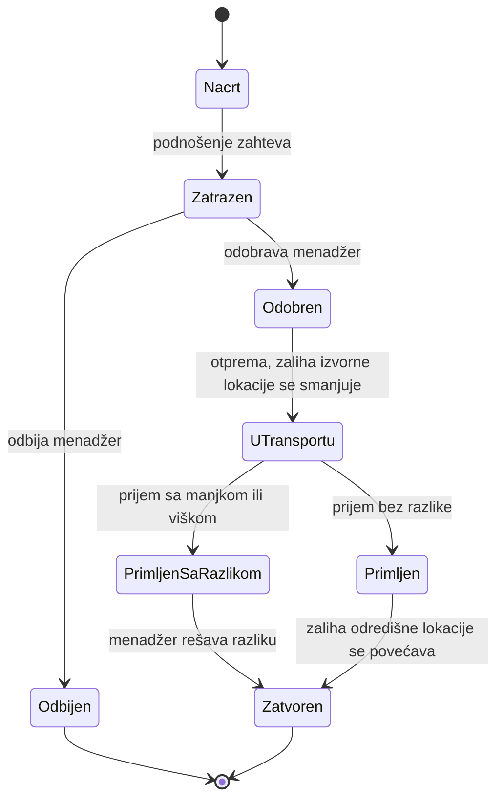

Roba u transportu ne pripada ni izvornoj ni odredišnoj lokaciji. Evidentira se kao posebno stanje, tako da ukupna količina u firmi uvek može da se objasni.

---

## 9. Preliminarna arhitektura i tehnološki stek

### 9.1 Pregled arhitekture

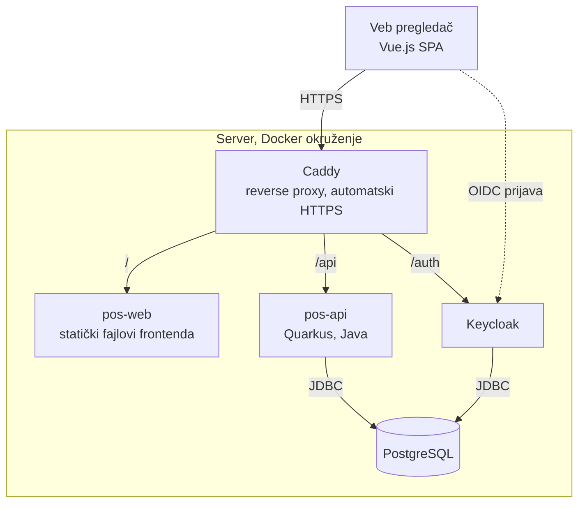

Frontend je jednostranična aplikacija (SPA) koja komunicira sa pozadinskim servisom preko REST API-ja. Sve zahteve prima Caddy, koji obezbeđuje HTTPS i prosleđuje saobraćaj. Korisnici i uloge se čuvaju u Keycloak-u, a poslovni podaci u PostgreSQL bazi.

### 9.2 Slojevita (clean) arhitektura pozadinskog servisa

Pozadinski servis je organizovan u slojeve tako da zavisnosti uvek pokazuju ka unutra. Domenski sloj ne zna ništa o bazi, veb okviru ni autentikaciji, što omogućava testiranje poslovnih pravila bez infrastrukture i kasniju zamenu pojedinih delova (na primer dodavanje fiskalizacije).

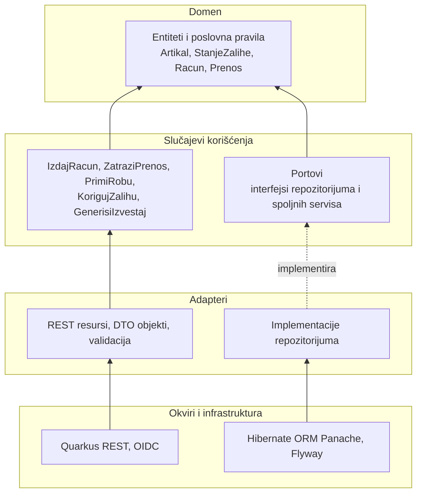

Predviđena struktura paketa:

```text
pos-api/
  src/main/java/org/vendora/pos/
    domain/            entiteti, vrednosni objekti, domenska pravila
    application/       slučajevi korišćenja i portovi (interfejsi)
    adapter/
      in/rest/         REST resursi, DTO, mapiranje
      out/persistence/ repozitorijumi, JPA entiteti, migracije
      out/fiscal/      port za fiskalizaciju (kasnija integracija)
    config/            konfiguracija, sigurnost
```

### 9.3 Tehnološki stek i obrazloženje

| Oblast | Izbor | Obrazloženje |
|---|---|---|
| Pozadinski servis | Java, Quarkus | Brzo pokretanje i mala potrošnja memorije, dobra podrška za kontejnere, razvijeni moduli za REST, OIDC i bazu. Java je dominantna u poslovnim sistemima. |
| Arhitektura | Clean arhitektura | Izdvaja poslovna pravila od infrastrukture, olakšava testiranje i promenu tehnologija. |
| Baza podataka | PostgreSQL | Pouzdane ACID transakcije i zaključavanje na nivou reda, ključni za konzistentnost zaliha. Migracije šeme preko Flyway-a. |
| Autentikacija i autorizacija | Keycloak | Gotov, standardizovan (OIDC, OAuth 2.0) sistem za korisnike, uloge i prijavu. Izbegava se samostalna izrada bezbednosno osetljivih funkcija. |
| Reverse proxy | Caddy | Automatsko izdavanje i obnavljanje HTTPS sertifikata, jednostavna konfiguracija. |
| Kontejneri | Docker, Docker Compose | Isto okruženje u razvoju, testu i produkciji, pokretanje celog sistema jednom komandom. |
| Frontend | Vue.js 3, JavaScript, Bun | Jednostavna krivulja učenja, komponentni pristup, Bun kao brz alat za upravljanje paketima i izvršavanje skripti. Pinia za stanje, Vue Router za navigaciju. |
| Testiranje | JUnit 5, RestAssured, Testcontainers, Vitest | Testovi sa pravom PostgreSQL bazom u kontejneru daju pouzdanu proveru ponašanja zaliha. |
| Verzionisanje i CI | Git, GitHub, GitHub Actions | Automatska izgradnja i testovi pri svakom pull request-u. |
| Upravljanje projektom | Jira, Confluence | Backlog i sprintovi, odnosno dokumentacija na jednom mestu. |
| Komunikacija | Discord | Svakodnevna komunikacija, daily sastanci. |

### 9.4 Okruženje za isporuku

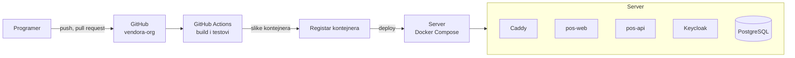

---

## 10. Metodologija razvoja i plan projekta

### 10.1 Izbor metodologije i obrazloženje

Ne postoji metodologija koja je najbolja u svim okolnostima. Izbor zavisi od okruženja projekta, pa smo ga doneli na osnovu sledećih činjenica o našem projektu:

| Karakteristika projekta | Posledica za izbor |
|---|---|
| Ključni rizik je tehnički (konkurentne izmene zaliha, Keycloak, clean arhitektura) | Potrebna je faza u kojoj se arhitektura dokazuje izvršivim kodom pre masovne izgradnje |
| Oblast je jasna, ali nemamo pravog klijenta za stalne povratne informacije | Potrebni su dokumentovani zahtevi i modeli, a ne samo kratki razgovori |
| Mali tim (4 člana) sa ograničenim vremenom zbog fakultetskih obaveza | Potrebna je laka svakodnevna organizacija, bez teškog procesa |
| Predmet i ocenjivanje zahtevaju jasne milestone-ove i artefakte | Odgovara fazama i dokumentima RUP-a |

Zbog toga biramo **RUP (Rational Unified Process)** kao okvir za faze, milestone-ove i artefakte. Unutar iteracija koristimo **Scrum elemente** (sprintovi od dve nedelje, backlog, daily, review i retrospektiva) jer su lagani i dobro odgovaraju timu ove veličine. Alati Jira i Confluence podržavaju oba pristupa.

RUP donosi četiri osobine koje nam odgovaraju: razvoj je iterativan i inkrementalan, vođen slučajevima korišćenja, usmeren na arhitekturu i usmeren na rano smanjenje rizika.

### 10.2 Faze i milestone-ovi

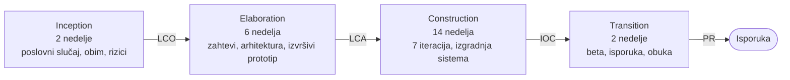

| Faza | Trajanje | Glavni ciljevi | Milestone |
|---|---|---|---|
| **Inception** | 2 nedelje (12.10. do 25.10.2026.) | Definisati problem, obim i viziju. Napraviti poslovni slučaj i okvirnu procenu. Identifikovati ključne rizike i podskup zahteva. Skicirati arhitekturu. | **LCO** (ciljevi životnog ciklusa): saglasnost o obimu, troškovima i rizicima |
| **Elaboration** | 6 nedelja (26.10. do 6.12.2026.) | Specifikacija zahteva, use-case model, analiza i dizajn, GUI prototip. Izvršiva osnovna arhitektura (Keycloak prijava, vertikalni presek prodaje sa smanjenjem zalihe). Rešavanje najvećih rizika. Detaljan plan Construction faze. | **LCA** (arhitektura životnog ciklusa): stabilna arhitektura, rizici smanjeni, plan potvrđen |
| **Construction** | 14 nedelja (7.12.2026. do 14.3.2027.) | Izgradnja sistema kroz 7 iteracija. Svaka iteracija se završava radnim inkrementom i regresionim testom. | **IOC** (početna operativna sposobnost): sistem spreman za beta testiranje |
| **Transition** | 2 nedelje (15.3. do 28.3.2027.) | Beta testiranje sa pilot korisnicima, ispravke, korisničko uputstvo, puštanje u produkciju. | **PR** (izdanje proizvoda) |

Svaka iteracija obuhvata pet osnovnih tokova posla iz RUP-a (zahtevi, analiza, dizajn, implementacija, test), u različitom udelu zavisno od faze. U Inception i Elaboration fazi dominiraju zahtevi, analiza i dizajn, a u Construction fazi implementacija i test.

### 10.3 Vremenski plan

Datumi su okvirni i usklađuju se sa fakultetskim obavezama (ispitni rokovi, praznici). Plan ima ugrađenu rezervu od 14 č-d.

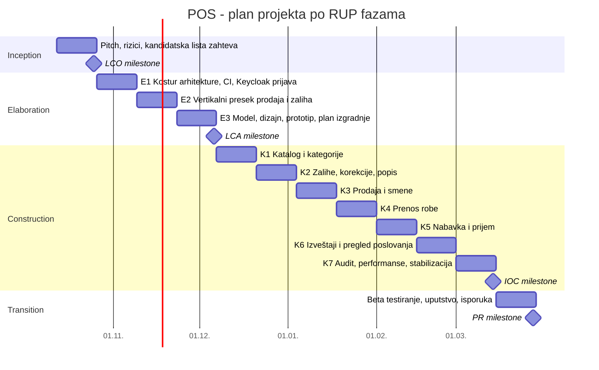

### 10.4 Plan iteracija

| Iteracija | Sadržaj | Zahtevi |
|---|---|---|
| E1 | Kostur Quarkus projekta u clean arhitekturi, Docker Compose okruženje, CI pipeline, Keycloak realm, prijava | F-01 |
| E2 | Vertikalni presek: artikal, lokacija, stanje zalihe i izdavanje računa sa atomarnim smanjenjem zalihe, test konkurentnosti | F-03 (osnovno), F-05, F-06 (osnovno), F-10 (osnovno) |
| E3 | Detaljni use-case-ovi, model analize i dizajna, model baze, GUI prototip, plan Construction faze | F-02 |
| K1 | Katalog artikala i kategorije, cenovnik | F-03, F-04 |
| K2 | Zalihe, minimalne količine, korekcije, popis | F-06, F-07, F-08, F-09 |
| K3 | Prodaja u celosti, načini plaćanja, storno, zatvaranje smene | F-10, F-11, F-12, F-13 |
| K4 | Prenos robe sa celim tokom stanja | F-14, F-15, F-16 |
| K5 | Dobavljači, porudžbenice, prijem robe | F-17, F-18, F-19 |
| K6 | Izveštaji, kartica artikla, predlog dopune, pregled poslovanja, izvozi | F-20, F-21, F-22, F-23, F-24 |
| K7 | Evidencija radnji, test opterećenja, bezbednosno testiranje, ispravke | F-25, N-03, N-04, N-02 |

Raspored se potvrđuje na planiranju svakog sprinta i menja se u skladu sa prioritetima i stvarnom brzinom tima.

### 10.5 Ritam rada unutar iteracije (Scrum elementi)

Svaka iteracija u fazama Elaboration i Construction traje dva nedelje i odgovara jednom Scrum sprintu.

| Događaj | Kada | Trajanje | Svrha |
|---|---|---|---|
| Sprint planning | Prvi dan | do 2 sata | Izbor stavki iz backlog-a i razrada u zadatke |
| Daily | Svaki radni dan | 15 minuta (Discord) | Šta je urađeno, šta sledi, šta koči |
| Sprint review | Poslednji dan | 1 sat | Demonstracija inkrementa |
| Retrospektiva | Poslednji dan | 1 sat | Šta poboljšati u načinu rada |

Kapacitet jednog sprinta je 4 člana x 2 nedelje x 20 sati = 160 sati, odnosno 20 č-d.

---

## 11. Tim, alati i organizacija rada

### 11.1 Uloge u timu

Uloge su kombinovane jer tim ima četiri člana. Raspodela je predlog i potvrđuje se na prvom sastanku, a uloge Scrum Master-a i Product Owner-a mogu se rotirati po fazama.

| Član | RUP uloga | Scrum uloga | Težište rada |
|---|---|---|---|
| Mladen Stanimirović | Analitičar zahteva | Product Owner | Zahtevi, use-case-ovi, prioriteti, dokumentacija, komunikacija sa pilot korisnicima |
| Jovan Vidović | Inženjer procesa i isporuke | Scrum Master | Organizacija sprintova, CI/CD, kontejneri, Keycloak i Caddy konfiguracija |
| Vladimir Mileticki | Arhitekta | Razvojni tim | Arhitektura, domen, pozadinski servis, baza podataka |
| Lazar Vučković | Projektant korisničkog interfejsa | Razvojni tim | Frontend, GUI prototip, upotrebljivost |

Svi članovi razvijaju, pregledaju kod i učestvuju u testiranju.

### 11.2 Alati

| Alat | Namena u projektu |
|---|---|
| **Jira** (projekat POS) | Product backlog, sprintovi, praćenje zadataka i grešaka, izveštaji o brzini tima |
| **Confluence** (prostor POS) | Dokumentacija: SRS/PRD, arhitektura, use-case-ovi, zapisnici sastanaka, retrospektive, registar rizika |
| **GitHub** (organizacija vendora-org) | Repozitorijumi pos-api, pos-web, pos-infra i pos-docs, pull request-ovi, GitHub Actions |
| **Discord** | Komunikacija, daily sastanci, kanali po temama (opšte, razvoj, deploy, dokumentacija) |

Struktura Confluence prostora: Početna, Vizija i poslovni slučaj, Zahtevi, Analiza i dizajn, Arhitektura, Testiranje, Upravljanje projektom (rizici, plan, sastanci), Uputstva.

### 11.3 Tok zadatka u Jiri

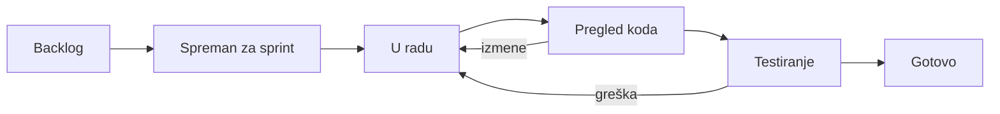

Broj zadataka u radu po članu ograničen je na dva (WIP limit), kako bi se izbegao nedovršen posao i prebacivanje između zadataka.

### 11.4 Radne konvencije

**Definicija spremnosti (Definition of Ready)** za stavku backlog-a: opisana je kao korisnička priča sa kriterijumima prihvatanja, procenjena, bez nerešenih zavisnosti.

**Definicija završenosti (Definition of Done)** za stavku backlog-a:

1. kod je pregledan i odobren u pull request-u (najmanje jedno odobrenje),
2. automatski testovi prolaze u CI pipeline-u,
3. domenska logika je pokrivena jediničnim testovima,
4. funkcionalnost je proverena na test okruženju,
5. dokumentacija je ažurirana (Confluence, OpenAPI),
6. kriterijumi prihvatanja su zadovoljeni i potvrdio ih je Product Owner.

**Konvencije za Git:** glavna grana je uvek spremna za isporuku, rad ide u kratkim granama (po zadatku iz Jire, na primer `POS-123-izdavanje-racuna`), a poruke commit-a prate konvenciju *Conventional Commits*.

---

## 12. Upravljanje rizicima

Rizici su razvrstani prema podeli iz predavanja: funkcionalni, nefunkcionalni (tehnički) i upravljački (unutrašnji i spoljašnji). Verovatnoća (V) i uticaj (U) ocenjuju se skalom 1 (mala), 2 (srednja), 3 (velika), a izloženost je njihov proizvod. Strategije su: izbeći, izolovati, napasti i pratiti.

| ID | Rizik | Vrsta | V | U | Izloženost | Strategija | Mera |
|---|---|---|---|---|---|---|---|
| R-01 | Sistem se ne može koristiti za stvarnu maloprodaju bez integracije sa fiskalizacijom i sertifikacije rešenja | Upravljački, spoljašnji | 3 | 3 | 9 | Izolovati | Fiskalizacija je van obima faksa, ali arhitektura predviđa poseban port. Pre komercijalizacije ispitati sertifikaciju ili saradnju sa već sertifikovanim rešenjem (Prilog B). |
| R-02 | Konkurentne izmene zaliha dovode do pogrešnog stanja | Nefunkcionalni | 2 | 3 | 6 | Napasti | Atomarno uslovno ažuriranje u transakciji, test konkurentnosti u iteraciji E2, dnevnik promena zaliha. |
| R-03 | Obim raste tokom razvoja (scope creep) | Upravljački, unutrašnji | 3 | 2 | 6 | Izolovati | MVP sa jasno definisanim obimom, promene kroz Product Owner-a, ostalo u backlog sa nižim prioritetom. |
| R-04 | Nedostupnost članova tima zbog ispita i drugih obaveza | Upravljački, unutrašnji | 3 | 2 | 6 | Pratiti | Rezerva u planu (14 č-d), deljenje znanja, obavezan pregled koda, kapacitet se unosi u planiranje svakog sprinta. |
| R-05 | Prodavnica privremeno nema internet vezu, kasa ne radi | Funkcionalni | 2 | 3 | 6 | Izbeći | Prva verzija jasno navodi zahtev za stalnom vezom. Offline režim (PWA, sinhronizacija) planira se kao naredna verzija. |
| R-06 | Zrela konkurentska rešenja | Upravljački, spoljašnji | 3 | 2 | 6 | Pratiti | Fokus na usku nišu (mala i srednja višelokacijska maloprodaja), jednostavno uvođenje, lokalizacija. |
| R-07 | Nedovoljno iskustva tima sa Quarkus clean arhitekturom, Keycloak-om i Bun-om | Upravljački, unutrašnji | 2 | 2 | 4 | Napasti | Istraživački zadaci (spike) u iteraciji E1, parovno programiranje, interna dokumentacija. |
| R-08 | Zahtevi nisu proverena sa stvarnim korisnicima | Funkcionalni | 2 | 2 | 4 | Napasti | Intervjui sa 3 do 5 vlasnika ili menadžera maloprodaja u fazi Elaboration, GUI prototip na proveri. |
| R-09 | Složena konfiguracija Keycloak-a (realm, uloge, mapiranje) | Nefunkcionalni | 2 | 2 | 4 | Izolovati | Konfiguracija realm-a u repozitorijumu i automatski uvoz, uputstvo u Confluence-u. |
| R-10 | Spori izveštaji nad velikim brojem računa | Nefunkcionalni | 2 | 2 | 4 | Napasti | Indeksi, agregirane tabele ili prikazi, test opterećenja u iteraciji K7. |
| R-11 | Bezbednosni propust ili gubitak podataka | Nefunkcionalni | 1 | 3 | 3 | Izbeći | HTTPS preko Caddy-ja, minimalne privilegije, dnevne rezervne kopije, bezbednosni pregled u iteraciji K7. |

Registar se ažurira na kraju svakog sprinta, a rizici sa izloženošću 6 i više prate se na svakom sprint review-u.

---

## 13. Okvirna procena troškova i opravdanosti

Ovo je početna procena koja je u RUP-u deo poslovne studije u fazi Inception. Detaljna analiza troškova i koristi (cost-benefit) izrađuje se za naredni kolokvijum. Sve cene su u evrima i zasnovane na pretpostavkama koje su navedene.

### 13.1 Pretpostavke

| Pretpostavka | Vrednost |
|---|---|
| Veličina tima | 4 člana |
| Trajanje razvoja | 24 nedelje |
| Angažovanje po članu | 20 sati nedeljno |
| Kalkulativna cena rada | 20 EUR po satu (nivo početnika u razvoju softvera) |
| Cena pretplate (prosek) | 79 EUR mesečno po klijentu |

### 13.2 Trošak razvoja

| Stavka | Obračun | Iznos (EUR) |
|---|---|---|
| Rad tima (kalkulativno) | 4 x 24 x 20 h = 1.920 h x 20 EUR | 38.400 |
| Server za razvojno i test okruženje | 25 EUR x 6 meseci | 150 |
| Domen | godišnje | 15 |
| Jira, Confluence, GitHub, Discord | besplatni planovi (Atlassian besplatni plan podržava do 10 korisnika) | 0 |
| TLS sertifikati, Keycloak, Quarkus, PostgreSQL, Caddy, Bun, Vue.js | softver otvorenog koda | 0 |
| **Ukupno novčani troškovi razvoja** | | **165** |
| **Ukupna kalkulativna vrednost razvoja** | | **38.565** |

Studenti za rad ne primaju novčanu naknadu, pa su stvarni novčani troškovi razvoja mali. Kalkulativna vrednost rada se ipak uračunava jer pokazuje šta bi isti proizvod koštao da ga razvija firma.

### 13.3 Operativni troškovi nakon puštanja u rad (mesečno)

| Stavka | Iznos (EUR) |
|---|---|
| Produkcioni server sa rezervnim kopijama | 60 |
| Monitoring i servis za slanje e-pošte | 15 |
| Podrška i održavanje (oko 10 h x 20 EUR) | 200 |
| Marketing i prodaja | 100 |
| **Ukupno** | **375** |

### 13.4 Model prihoda

| Paket | Obim | Cena mesečno (EUR) |
|---|---|---|
| Start | do 2 lokacije, do 3 korisnika | 29 |
| Standard | do 6 lokacija, do 15 korisnika | 79 |
| Poslovni | do 20 lokacija, neograničen broj korisnika | 149 |

Cene su početna pretpostavka i treba ih proveriti kroz razgovore sa potencijalnim klijentima.

### 13.5 Prag isplativosti

- **Pokrivanje operativnih troškova:** 375 EUR / 79 EUR = 4,7, dakle **5 plaćenih klijenata**.
- **Povraćaj kalkulativne vrednosti razvoja** zavisi od broja klijenata:

| Broj klijenata | Mesečni prihod (EUR) | Mesečna dobit posle operativnih troškova (EUR) | Povraćaj ulaganja od 38.400 EUR |
|---|---|---|---|
| 10 | 790 | 415 | oko 93 meseca |
| 20 | 1.580 | 1.205 | oko 32 meseca |
| 30 | 2.370 | 1.995 | oko 19 meseci |
| 50 | 3.950 | 3.575 | oko 11 meseci |

Zaključak procene: proizvod postaje komercijalno isplativ pri 30 i više klijenata, uz povraćaj ulaganja od oko dve godine. Ako se rad tima ne računa kao trošak, projekat pokriva novčane troškove već sa 5 klijenata. Ova procena ne uračunava troškove fiskalne sertifikacije (rizik R-01), koji se moraju proceniti pre komercijalizacije.

### 13.6 Očekivane koristi za klijenta (hipoteze)

Koristi za klijenta nisu u ovoj fazi izmerene i predstavljaju hipoteze koje treba proveriti u razgovorima sa potencijalnim korisnicima:

- manje vremena utrošenog na ručno objedinjavanje stanja i izveštaja,
- manji gubici zbog manjkova i neevidentiranih razlika,
- manje izgubljene prodaje zbog nestašica koje su mogle biti pokrivene prenosom iz druge lokacije,
- manje vezanog novca u zalihama zahvaljujući boljoj nabavci.

Ilustrativni primer: za firmu sa mesečnim prometom od 100.000 EUR, smanjenje izgubljene prodaje od samo 0,5% iznosi 500 EUR mesečno, što je više od šest puta veće od cene paketa Standard. Ovo je računski primer, a ne izmerena vrednost.

---

## 14. Validacija ideje i kriterijumi uspeha

### 14.1 Plan validacije

Pretpostavke o problemu i rešenju proveravamo u fazi Elaboration:

1. Strukturisani intervjui sa 3 do 5 vlasnika ili menadžera firmi koje imaju više prodavnica: kako danas vode zalihe, koliko često se desi neslaganje stanja, koliko vremena odlazi na usklađivanje, šta bi bilo vredno plaćanja.
2. Pregled GUI prototipa sa istim sagovornicima.
3. Provera cenovnih paketa.
4. Dopuna analize konkurencije.

### 14.2 Kriterijumi uspeha

| Kriterijum | Cilj |
|---|---|
| Tačnost stanja | Razlika između evidentiranog i stvarnog stanja pri popisu manja od 1% artikala |
| Brzina rada na kasi | Račun sa 5 stavki izdat za manje od 60 sekundi |
| Vreme do izveštaja | Izveštaj o prodaji i zalihama svih lokacija dostupan za manje od 10 sekundi |
| Prenos robe | 100% prenosa ima potpun tok sa potvrdom otpreme i prijema |
| Kvalitet | Pokrivenost domenskog sloja testovima od najmanje 70%, nijedna kritična greška otvorena na kraju Transition faze |
| Prihvaćenost | Najmanje 2 pilot korisnika u fazi Transition |

---

## 15. Kriterijumi za završetak početne faze i naredni koraci

### 15.1 Kriterijumi za milestone LCO

Početna faza se smatra završenom kada su ispunjeni sledeći uslovi:

- [x] problem i vizija proizvoda su definisani i usaglašeni u timu,
- [x] ciljna grupa i korisničke uloge su identifikovane,
- [x] obim prve isporuke i stavke van obima su određene,
- [x] kandidatska lista zahteva sa prioritetima, rizicima i procenom je sastavljena,
- [x] preliminarni model sistema (kontekst, slučajevi korišćenja, model domena) je izrađen,
- [x] preliminarna arhitektura i tehnološki stek su predloženi i obrazloženi,
- [x] metodologija je izabrana i obrazložena, plan po fazama je napravljen,
- [x] ključni rizici su identifikovani sa merama,
- [x] okvirna procena troškova i opravdanosti je urađena,
- [ ] pitch je predstavljen i dobijena je povratna informacija (prvi kolokvijum).

### 15.2 Naredni koraci (faza Elaboration)

1. Podešavanje alata: GitHub organizacija i repozitorijumi, Jira projekat POS, Confluence prostor, Discord kanali.
2. Intervjui sa potencijalnim korisnicima i dopuna zahteva.
3. Detaljna specifikacija zahteva (SRS) i korisničke priče sa kriterijumima prihvatanja.
4. Detaljni opisi slučajeva korišćenja.
5. Model analize (granične, kontrolne i entitetske klase) i model dizajna.
6. Model baze podataka (ER dijagram).
7. GUI prototip glavnih ekrana.
8. Izvršiva osnovna arhitektura (iteracije E1 i E2).
9. Detaljna analiza troškova i koristi (cost-benefit) i plan Construction faze.

---

## 16. Prilog A: Pojmovnik

| Pojam | Značenje |
|---|---|
| Lokacija | Prodavnica ili skladište firme |
| Stanje zalihe | Količina jednog artikla na jednoj lokaciji |
| Prenos | Premeštanje robe između dve lokacije iste firme |
| Prijem | Evidentiranje robe koja je stigla na lokaciju (od dobavljača ili iz prenosa) |
| Porudžbenica | Dokument kojim se roba naručuje od dobavljača |
| Popis | Fizičko prebrojavanje zaliha i usklađivanje sa evidencijom |
| SaaS | Softver kao usluga, naplaćuje se pretplatom |
| OIDC | OpenID Connect, standard za prijavu korisnika |
| RBAC | Kontrola pristupa zasnovana na ulogama |
| SPA | Jednostranična veb aplikacija |
| RUP | Rational Unified Process, iterativni i inkrementalni proces razvoja |
| LCO, LCA, IOC, PR | Milestone-ovi RUP-a: ciljevi životnog ciklusa, arhitektura životnog ciklusa, početna operativna sposobnost, izdanje proizvoda |
| WIP limit | Ograničenje broja zadataka koji se istovremeno rade |
| Č-d | Čovek-dan, osam radnih sati jedne osobe |
| ESIR, PFR, SUF | Elektronski sistem za izdavanje računa, procesor fiskalnih računa i sistem za upravljanje fiskalizacijom Poreske uprave |

---

## 17. Prilog B: Pravni okvir i fiskalizacija

U Srbiji se promet na malo mora evidentirati preko elektronskog fiskalnog uređaja u skladu sa Zakonom o fiskalizaciji, koji se primenjuje od 2022. godine. Programsko rešenje koje izdaje račune (ESIR) mora biti sertifikovano kod Poreske uprave. Račun se priprema i potpisuje preko procesora fiskalnih računa (PFR) i u realnom vremenu prenosi u sistem za upravljanje fiskalizacijom (SUF).

Posledice po projekat:

1. POS u prvoj isporuci evidentira prodaju i zalihe, ali **ne zamenjuje fiskalni uređaj**. Za stvarnu upotrebu u maloprodaji potrebna je naknadna integracija sa sertifikovanim ESIR rešenjem.
2. Arhitektura u adapterskom sloju predviđa poseban izlazni port za fiskalizaciju (`adapter/out/fiscal`), tako da se integracija može dodati bez izmene domenskog sloja.
3. Troškovi i rokovi sertifikacije nisu uključeni u procenu iz poglavlja 13 i predmet su dodatne analize.
4. Otvoreno pitanje: da li se evidencija prevoza robe (sistem elektronskih otpremnica) odnosi i na interne prenose između sopstvenih objekata firme. Ovo treba proveriti pre implementacije funkcije prenosa.

Pravne obaveze i uslovi sertifikacije mogu se menjati, pa se pre komercijalizacije proveravaju kod Poreske uprave i pravnog savetnika. Ovaj dokument ne predstavlja pravni savet.

---

*Kraj dokumenta.*
